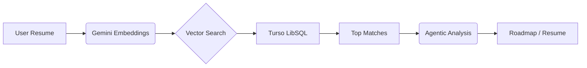

<div align="center">

<!-- 🌟 MAGNIFICENT HERO SECTION 🌟 -->
<p align="center">
  
</p>

<h2 align="center" style="border: none; margin-top: -10px;">
  <span style="color: #E2B96E;">✨</span> 
  <i>Made with Love for the Future of Recruitment</i> 
  <span style="color: #E2B96E;">✨</span>
</h2>

<p align="center">
  <b>━━━━━━━━━━━━━━━━━━━━━ ◈ ━━━━━━━━━━━━━━━━━━━━━</b>
</p>

<br />

<div align="center">
  <blockquote>
    "Empowering talent to meet opportunity through the precision of Career Intelligence."
  </blockquote>
</div>

<br />

<h1 align="center" style="font-size: 60px; font-weight: 900; letter-spacing: -2px; color: #1C1A16; margin-bottom: 0;">
  Skill<span style="color: #E2B96E;">Sync</span><span style="color: #E2B96E; opacity: 0.5;">.</span>
</h1>
<p align="center" style="font-size: 10px; font-weight: 800; letter-spacing: 5px; color: #948F85; text-transform: uppercase; margin-top: -5px;">
  Career Intelligence Engine
</p>

<br />

<div align="center">
  
  
  
</div>

<br />

<div align="center">
  <a href="#-rapid-deployment">⚡ Quick Start</a> •
  <a href="#-core-intelligence-modules">🧠 Features</a> •
  <a href="#-system-pulse--architecture">⚙️ Architecture</a> •
  <a href="#-the-power-stack">🛠️ Stack</a>
</div>

<br />

---

## ⚡ Rapid Deployment

Get **SkillSync** up and running in your local environment in four simple steps:

1. **Clone the Core**: `git clone https://github.com/KunjAgwl/SkillSyncPro.git`
2. **Ignite Backend**: `cd server && npm install && npm run dev`
3. **Launch Frontend**: `cd client && npm install && npm run dev`
4. **Initialize DB**: Ensure your `.env` contains your Turso & Gemini credentials.

---

## ✨ Core Intelligence Modules

<table width="100%">
  <tr>
    <td width="50%" valign="top">
      <h3>🎯 Precision Matcher</h3>
      <p><i>3072-Dimensional Vector Analysis</i></p>
      <ul>
        <li>Semantic context understanding</li>
        <li>Real-time weight boosting</li>
        <li>Hybrid keyword fallback</li>
      </ul>
    </td>
    <td width="50%" valign="top">
      <h3>🤖 Career Concierge</h3>
      <p><i>Multi-Turn Agentic Reasoning</i></p>
      <ul>
        <li>Interactive profile interviews</li>
        <li>Gaps-to-Goals analysis</li>
        <li>Personalized pivot coaching</li>
      </ul>
    </td>
  </tr>
  <tr>
    <td width="50%" valign="top">
      <h3>🗺️ Skill Roadmaps</h3>
      <p><i>Hyper-Curated Learning Paths</i></p>
      <ul>
        <li>Automatic milestone generation</li>
        <li>Direct resource linking</li>
        <li>Timeline estimation logic</li>
      </ul>
    </td>
    <td width="50%" valign="top">
      <h3>✍️ Resume Alchemist</h3>
      <p><i>Contextual Bullet Optimization</i></p>
      <ul>
        <li>Job-specific rewriting</li>
        <li>Impact-focused phrasing</li>
        <li>Tech-stack prioritization</li>
      </ul>
    </td>
  </tr>
</table>

---

## 🎨 Design Philosophy: Neumorphism

SkillSync embraces the **Neumorphic** design trend, focusing on soft shadows, organic shapes, and a "tactile" interface.

- **Primary Accent**: `#E2B96E` (Champagne Gold)
- **Atmospheric Shadows**: Dual-tone shadows that create depth on a light or dark canvas.
- **Interactive States**: Buttons that "press" into the UI and cards that float with elegance.

---

## 🔍 The Directory X-Ray

```bash
SkillSync/
├── client/                 # 🖼️ Frontend Engine (React + Vite)
│   ├── src/components/     # 🧩 Modular UI Components
│   └── src/tabs/           # 📑 Primary Feature Controllers
├── server/                 # 🧠 Intelligence Hub (Node + Express)
│   ├── routes/             # 📡 API Gateway
│   ├── services/           # 🧬 Core AI & Search Logic
│   └── config/             # 🗄️ Database Orchestration
└── ...                     # 🔧 Project Meta & Config
```

---

## 🧠 System Pulse & Architecture



<br />

<div align="center">
  
  
  
</div>

---

## 🛠️ The Power Stack

<p align="center">
  <b>Frontend Engine</b><br/>
  
  
  
  
</p>

<p align="center">
  <b>Backend & Intelligence</b><br/>
  
  
  
  
</p>

---

## 🛰️ Future Velocity

- [ ] [**Q3 2026**] **Multimodal Analysis**: Support for video resumes and portfolio scanning.
- [ ] [**Q4 2026**] **Auto-Apply Agent**: Autonomous job application workflow.
- [ ] [**Q1 2027**] **Web3 Credentialing**: On-chain skill verification via SkillSync Proofs.

---

## 🚀 Knowledge Hub

Check out the detailed documentation for each layer:

- 🏗️ **[Backend Guide](BACKEND.md)**: Routes, Services, and AI Pipelines.
- 🗄️ **[Database Guide](DB_ARCHITECTURE.md)**: Vector schema and SQL indexing.

---

<div align="center">
  
  <p><i>Building the future of recruitment, one vector at a time.</i></p>
</div>
