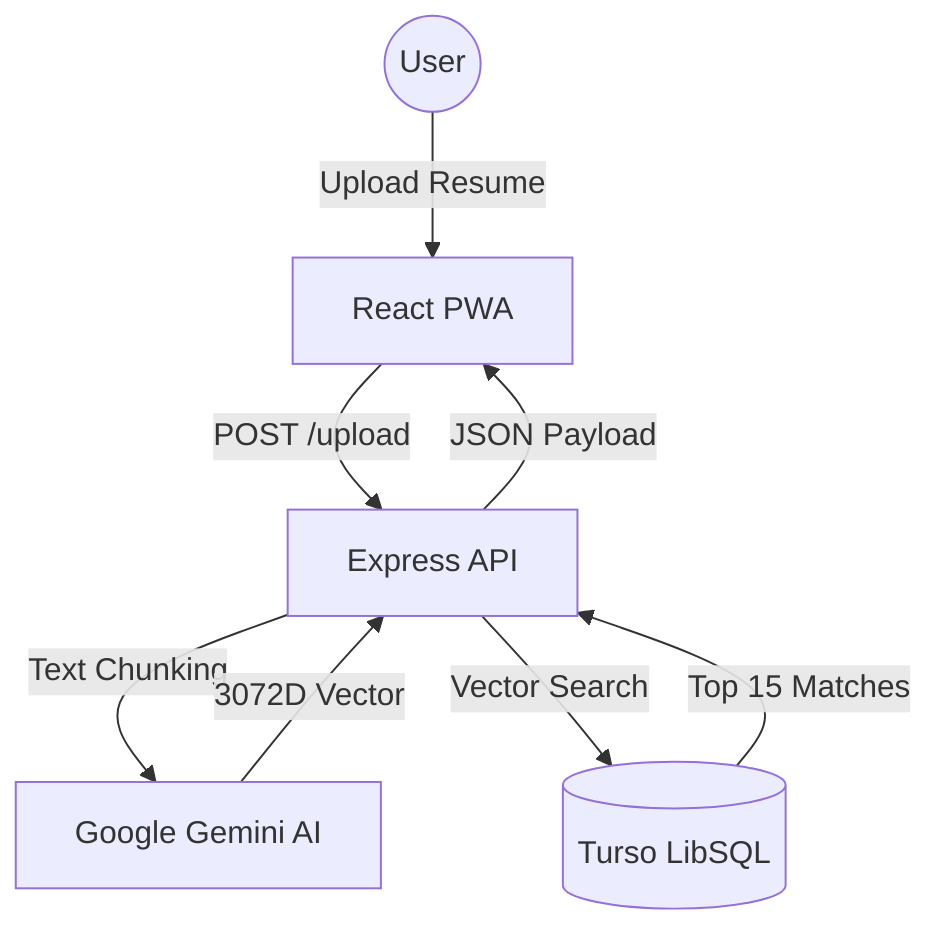

<!-- 🌟 MAGNIFICENT HERO SECTION 🌟 -->

  

<h2 align="center" style="border: none; margin-top: -10px;">
  ✨ 
  <i>Made with Love for the Future of Recruitment</i> 
  ✨
</h2>

  

 

<h1 align="center" style="font-size: 60px; font-weight: 900; letter-spacing: -2px; color: #1C1A16; margin-bottom: 0;">
  SkillSync.
</h1>

  Career Intelligence Engine

 

**SkillSync** is a premium, AI-powered Career Intelligence Engine that bridges the gap between your talent and the industry's most relevant opportunities. Designed with a **Neumorphic (Soft UI)** aesthetic, it offers a tactile, modern experience for job seekers and career builders.

---

## ✨ Key Features

### 🎯 Precision Matching
- **Semantic Vector Search**: Uses **3072-dimensional embeddings** to match your resume against thousands of jobs based on *meaning*, not just keywords.
- **Skill Boosting**: Dynamically adjust weights for specific skills to see how "upskilling" changes your compatibility in real-time.

### 🤖 Agentic Career Coach
- **AI Concierge**: An interactive agent that understands your professional profile.
- **Deep Insights**: Ask why you were matched, what's missing, or how to pivot your career path.

### 🗺️ Intelligent Roadmaps
- **Gap Analysis**: Identifies exactly which skills are keeping you from your dream job.
- **Curated Learning**: Generates structured milestones, specific resources, and realistic timelines to bridge those gaps.

### 📝 Resume Optimization
- **Context-Aware Rewriting**: Automatically rewrites your resume bullet points to better align with specific job descriptions.
- **Impact Maximization**: Focuses on quantifying achievements and highlighting relevant tech stacks.

### 📱 PWA & Mobile Native
- **Cross-Platform**: Built with **Capacitor** for a seamless mobile experience.
- **Haptic Feedback**: Tactile responses for every major interaction, creating a premium "app-like" feel.

---

## 🎨 Design Philosophy: Neumorphism

SkillSync embraces the **Neumorphic** design trend, focusing on soft shadows, organic shapes, and a "tactile" interface.

- **Primary Accent**: `#E2B96E` (Champagne Gold)
- **Atmospheric Shadows**: Dual-tone shadows that create depth on a light or dark canvas.
- **Interactive States**: Buttons that "press" into the UI and cards that float with elegance.

---

## 🏗️ Technical Architecture

---

## 🛠️ Tech Stack

- **Frontend**: Vite + React + Tailwind CSS (Custom Neumorphic Utilities)
- **Backend**: Node.js + Express.js
- **Database**: Turso (LibSQL) with Native Vector Support
- **AI**: Google Gemini Pro (Text & Embeddings)
- **Mobile**: Capacitor.js
- **Icons**: Google Material Symbols

---

## 🚀 Getting Started

Check out the detailed documentation for each layer:

- 🏗️ **[Backend Guide](BACKEND.md)**: Routes, Services, and AI Pipelines.
- 🗄️ **[Database Guide](DB_ARCHITECTURE.md)**: Vector schema and SQL indexing.

