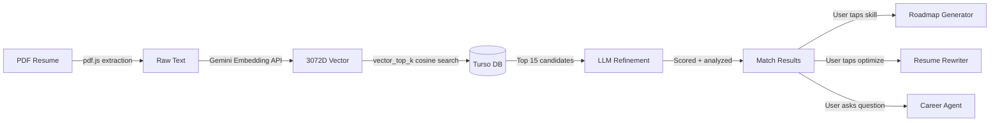

<div align="center">

<br />


<br /><br />

# SkillSync Pro

**Career Intelligence Engine** · Neumorphic Design · AI-Powered

<br />


<br /><br />

[Quick Start](#-quick-start) · [Features](#-what-skillsync-does) · [Architecture](#-how-it-works) · [Tech Stack](#-tech-stack) · [Docs](#-documentation)

<br />

</div>

---

## 🧬 What is SkillSync?

SkillSync Pro is a **full-stack AI career platform** that reads your resume, understands it semantically, and matches you against a live job database using **3072-dimensional vector embeddings**. It doesn't just find keyword overlaps — it understands the *meaning* behind your experience.

Built with a distinctive **Neumorphic (Soft UI)** design language featuring champagne gold accents (`#E2B96E`), soft dual-tone shadows, and tactile press interactions that make every tap feel physical.

> *"Not just another job board. A career intelligence engine that thinks."*

---

## ⚡ Quick Start

```bash
# 1. Clone
git clone https://github.com/KunjAgwl/SkillSyncPro.git && cd SkillSyncPro

# 2. Backend
cd server && npm install && npm run dev

# 3. Frontend (new terminal)
cd client && npm install && npm run dev
```

You'll need a `.env` in `server/` with:

```env
PORT=5000
TURSO_DATABASE_URL=your_turso_url
TURSO_AUTH_TOKEN=your_turso_token
GEMINI_API_KEY=your_gemini_key
```

---

## 🎯 What SkillSync Does

### 1. Hybrid Resume Matching

Upload a PDF resume and SkillSync runs a **3-stage intelligence pipeline**:

| Stage | What Happens |
|-------|-------------|
| **Embed** | Your resume text is converted into a 3072-dimension vector via `gemini-embedding-2-preview` |
| **Search** | The vector is matched against all jobs using `vector_top_k` cosine similarity on Turso |
| **Refine** | An LLM acts as a senior recruiter — scoring each match, extracting matched/missing skills, and ranking by technical alignment (70%) + experience maturity (30%) |

The result: a ranked list of your **top 15 job matches** with granular skill-gap analysis.

---

### 2. AI Career Agent — "SkillSync Intel"

A conversational agent that has access to both your resume and the job database. It can:

- **Answer questions** → *"Why am I only a 60% match for this role?"*
- **Query the database live** → *"How many frontend jobs are there?"*  
- **Give career advice** → *"What should I learn next to become a senior developer?"*

Under the hood, the agent decides whether to respond conversationally or generate and execute a SQL query against the live Turso database — all through a single unified prompt.

---

### 3. Skill Roadmap Generator

Found a skill gap? Tap any missing skill and SkillSync generates a **5-step structured learning plan** with:

- Step-by-step milestones (beginner → advanced)
- Time estimates tailored to your current experience
- Practical descriptions, not generic advice

The roadmap adapts based on your resume context and optional user constraints like *"I only have 2 hours per day"*.

---

### 4. Resume Optimizer

Select any matched job and SkillSync will **rewrite your resume** to align with that specific role:

- Extracts missing keywords from the job description
- Rewrites your professional summary
- Generates STAR-method bullet points for each experience block
- Outputs a complete, beautifully formatted **HTML resume** ready for download

---

### 5. Job Discovery

Browse the full job database with keyword search. Every job stored includes:
- Title, company, and full description
- Skills as parsed JSON
- A 3072-dimension embedding vector for semantic search

---

### 6. Scan History & Profile

Every match you run is persisted to the `scan_history` table. The profile tab shows your last 50 scans with timestamps, top match info, and scores — so you can track your career progress over time.

---

## 🏗 How It Works



---

## 📂 Project Structure

```
SkillSyncPro/
│
├── server/                          # Express.js backend
│   ├── index.js                     # Entry point, middleware, bootstrap
│   ├── config/
│   │   ├── db.js                    # Turso client + schema initialization
│   │   └── aiConfig.js              # AI provider configuration (Gemini/OpenRouter)
│   ├── routes/
│   │   └── api.js                   # All REST endpoints
│   ├── services/
│   │   ├── matchService.js          # Embed → Search → Refine pipeline
│   │   ├── aiService.js             # Embeddings, roadmaps, resume optimization
│   │   └── agentService.js          # Agentic reasoning + live DB queries
│   └── scripts/
│       ├── seed-jobs.js             # Populate job database
│       └── generate-embeddings.js   # Batch embed all jobs (768→3072 migration)
│
├── client/                          # React + Vite frontend
│   ├── src/
│   │   ├── App.jsx                  # Tab router + splash screen
│   │   ├── hooks/useSkillSync.js    # Central state + all API calls
│   │   ├── components/
│   │   │   ├── Header.jsx           # Neumorphic app header
│   │   │   ├── BottomNav.jsx        # Floating pill navigation bar
│   │   │   └── tabs/
│   │   │       ├── MatchTab.jsx     # Resume upload + results
│   │   │       ├── DiscoveryTab.jsx # Job search/browse
│   │   │       ├── CourseTab.jsx    # Skill roadmap viewer
│   │   │       ├── ResumeTab.jsx    # Optimized resume viewer
│   │   │       ├── AgentTab.jsx     # AI chat interface
│   │   │       └── ProfileTab.jsx   # Scan history + stats
│   │   └── index.css                # Neumorphic utilities + animations
│   ├── capacitor.config.json        # Android/iOS build config
│   └── tailwind.config.js           # Custom color palette + shadow tokens
│
├── BACKEND.md                       # Detailed backend documentation
└── DB_ARCHITECTURE.md               # Database schema + vector indexing guide
```

---

## 🛠 Tech Stack

| Layer | Technology | Purpose |
|-------|-----------|---------|
| **Frontend** | React 18 + Vite | Component framework + fast HMR |
| **Styling** | Tailwind CSS | Neumorphic utility classes |
| **Mobile** | Capacitor.js | Native Android/iOS wrapper |
| **Backend** | Express 5 (Node.js) | REST API server |
| **Database** | Turso (LibSQL) | Edge SQLite with vector search |
| **AI - Embeddings** | `gemini-embedding-2-preview` | 3072D semantic vectors |
| **AI - Reasoning** | Gemini Pro / OpenRouter | Skill analysis + roadmaps + optimization |
| **PDF Parsing** | pdf.js | Client-side resume text extraction |
| **Haptics** | @capacitor/haptics | Tactile feedback on interactions |

---

## 🎨 Design System

SkillSync uses a custom **Neumorphic** design system built on Tailwind:

| Token | Value | Usage |
|-------|-------|-------|
| `primary` | `#E2B96E` | Champagne gold accent |
| `background-light` | `#F6F1E8` | Warm cream canvas |
| `background-dark` | `#1C1A16` | Deep charcoal dark mode |
| `neu-flat` | Dual outset shadow | Raised card effect |
| `neu-pressed` | Dual inset shadow | Pressed/active state |
| `neu-button` | Outset → inset on `:active` | Tactile button press |

Typography: **Manrope** (variable weight, geometric sans-serif)

---

## 🗄 Database

Two primary tables powered by **Turso LibSQL**:

**`jobs`** — The heart of the search engine
```sql
CREATE TABLE jobs (
  id INTEGER PRIMARY KEY AUTOINCREMENT,
  title TEXT, company TEXT, description TEXT,
  skills TEXT,                    -- JSON string
  embedding F32_BLOB(3072),       -- AI vector
  UNIQUE(title, company)
);
```

**`scan_history`** — Audit trail of every match
```sql
CREATE TABLE scan_history (
  id INTEGER PRIMARY KEY AUTOINCREMENT,
  resume_summary TEXT, top_match_title TEXT,
  top_match_company TEXT, match_score INTEGER,
  created_at DATETIME DEFAULT CURRENT_TIMESTAMP
);
```

Full schema details → [DB_ARCHITECTURE.md](DB_ARCHITECTURE.md)

---

## 📖 Documentation

| Document | What's Inside |
|----------|--------------|
| [**BACKEND.md**](BACKEND.md) | API endpoints, service architecture, middleware |
| [**DB_ARCHITECTURE.md**](DB_ARCHITECTURE.md) | Vector schema, indexing strategy, migration queries |

---

## 🛰 Roadmap

- [ ] **Multimodal input** — Video resume & portfolio scanning
- [ ] **Auto-apply agent** — Autonomous job application workflows  
- [ ] **Interview prep** — AI mock interviews based on matched roles
- [ ] **Analytics dashboard** — Career trajectory visualization

---

<div align="center">

<br />

**SkillSync Pro** · Built by **Avdhi & Kunj**

*Career intelligence, one vector at a time.*

<br />

</div>
